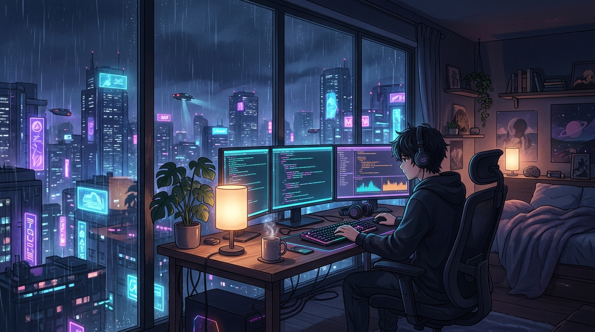

  

  

  
  
  
  
  

 

  <blockquote>
    <i>"If you do not like your destiny, do not accept it. Instead, have the courage to change it the way you want it to be."</i>
  </blockquote>

 

  <h3>⚡ Tech Arsenal & Ninjutsu</h3>
  

 

  <h3>🚀 Featured Public Projects</h3>

  <table border="0">
    <tr>
      <td align="center">
        
      </td>
      <td align="center">
        
      </td>
    </tr>
    <tr>
      <td align="center">
        
      </td>
      <td align="center">
        
      </td>
    </tr>
  </table>

 

  <h3>📊 Power Level & Stats</h3>
  

    
  

  

    
    
  

 

  

